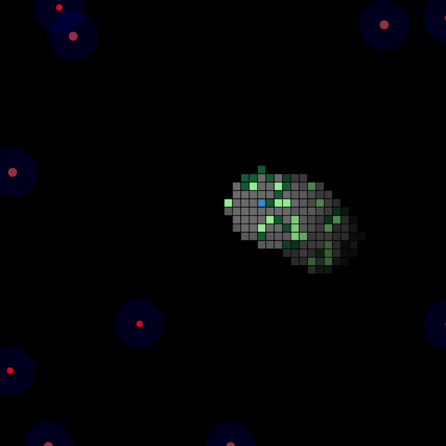

<div align="center">

# DroneEscapeJava

### Jeu d'infiltration procédural en Java / JavaFX

Exploration, furtivité, visibilité dynamique et coordination de drones autonomes.

</div>

---

## À propos

**DroneEscapeJava** est un jeu d'infiltration développé en **Java avec JavaFX**. Le joueur évolue dans une carte générée aléatoirement et doit retrouver une **clé**, puis rejoindre l'une des zones d'extraction placées au centre des quatre bordures de la carte.

La difficulté vient principalement de deux mécaniques : la visibilité limitée du joueur et la présence de drones autonomes. Le terrain est plongé dans l'obscurité, les obstacles modifient les déplacements et les lignes de vue, et une détection par un drone peut provoquer une alerte collective.

Chaque nouvelle exécution génère une partie différente : la disposition du terrain, la position de la clé et le placement des drones changent, tandis que les sorties restent volontairement fixes afin de conserver un objectif spatial identifiable.

---

## Aperçu

<p align="center">
  
</p>

Le joueur progresse dans une carte presque entièrement plongée dans l'obscurité. Les cases proches de sa position sont temporairement révélées, tandis que les drones patrouillent autour de la zone avec leur propre champ de vision. La clé apparaît en bleu, les obstacles en vert et les sorties sont placées au centre de chaque bordure.


---

## Objectif du jeu

Le déroulement d'une partie repose sur trois étapes :

1. **Explorer la carte** en évitant les obstacles et les champs de vision des drones.
2. **Trouver et récupérer la clé**, représentée par une cellule bleue dans la matrice.
3. **Atteindre une sortie** après avoir récupéré la clé. Les sorties sont les cellules jaunes situées au milieu de chacune des quatre bordures.

La partie est gagnée lorsque le joueur atteint une cellule d'extraction en possession de la clé.

La partie est perdue lorsque le joueur reste détecté continuellement par les drones pendant environ **5 secondes**.

---

## Contrôles

| Touche | Action |
| --- | --- |
| `↑` | Se déplacer vers le haut |
| `↓` | Se déplacer vers le bas |
| `←` | Se déplacer vers la gauche |
| `→` | Se déplacer vers la droite |

Les déplacements sont effectués cellule par cellule et respectent les limites de la carte ainsi que les obstacles définis dans la matrice.

---

## Génération procédurale de la carte

L'environnement repose sur une **matrice carrée de 54 × 54 cellules**. Dans la configuration actuelle, chaque cellule mesure **13 pixels**.

À chaque lancement, la matrice est reconstruite de manière aléatoire. Le code attribue une valeur numérique à chaque type de cellule, puis JavaFX transforme cette matrice en grille graphique.

| Valeur | Représentation | Rôle |
| ---: | --- | --- |
| `0` | Gris | Terrain libre |
| `1` | Vert clair | Obstacle |
| `3` | Bleu | Clé à récupérer |
| `4` | Jaune | Zone d'extraction |
| `5` | Vert foncé | Obstacle |

La génération utilise actuellement environ **15 % de cellules de type 1** et **15 % de cellules de type 5**. Ces cellules vertes constituent les zones bloquantes pour le joueur.

La clé est placée sur une position aléatoire de la matrice. Sa position change donc à chaque nouvelle exécution.

Les sorties ne sont pas aléatoires : deux cellules jaunes adjacentes sont placées au centre de chaque côté de la carte, soit en haut, en bas, à gauche et à droite.

---

## Brouillard et champ de vision du joueur

La carte n'est pas entièrement visible. Une couche noire est superposée à l'environnement afin de créer un système de **brouillard de guerre dynamique**.

Lorsque le joueur se déplace, les cellules situées dans un rayon de **4 cases** autour de sa position sont révélées. Les zones précédemment explorées ne restent cependant pas visibles indéfiniment.

Toutes les **0,3 seconde**, les cellules situées hors du champ de vision actuel deviennent progressivement plus opaques. Le taux d'assombrissement utilisé dans le code est de `0.15` par mise à jour.

Cela produit une visibilité temporaire :

```text
zone inconnue
    ↓
le joueur approche
    ↓
la zone devient visible
    ↓
le joueur s'éloigne
    ↓
la zone s'assombrit progressivement
```

Le joueur doit donc mémoriser une partie de l'environnement au lieu de disposer en permanence d'une carte complète.

---

## Drones et intelligence de poursuite

Le jeu instancie actuellement **10 drones** :

- 5 drones standards ;
- 5 méga-drones.

Les deux variantes possèdent une représentation graphique différente dans le code et utilisent le même système général de déplacement, de détection et de poursuite.

### Mode recherche

Tant qu'aucun joueur n'est détecté, chaque drone se déplace de manière autonome. Il possède une direction courante et en choisit une nouvelle lorsqu'il ne peut plus poursuivre son déplacement.

Les drones sont placés aléatoirement dans l'environnement avec une distance minimale entre eux afin d'éviter une concentration excessive au démarrage.

### Champ de vision

Chaque drone possède un champ de vision circulaire dont le rayon correspond à **3 cellules** de la grille.

La simple distance ne suffit pas pour détecter le joueur. Le programme vérifie également qu'aucun obstacle ne coupe la ligne entre le drone et la cible.

Cette vérification repose sur une logique de **ligne de vue inspirée de l'algorithme de Bresenham** : le trajet entre le drone et le joueur est parcouru cellule par cellule, et la détection est interrompue lorsqu'une cellule bloquante se trouve entre eux.

### Alerte collective

Lorsqu'un drone détecte le joueur, sa position est transmise à l'ensemble des drones grâce à `informerDrones(...)`.

Les drones quittent alors leur comportement d'exploration pour se diriger vers la position signalée.

```text
Un drone détecte le joueur
           ↓
   Déclenchement de l'alerte
           ↓
Position transmise aux autres drones
           ↓
     Convergence des drones
```

Cette mécanique rend une détection plus dangereuse qu'une simple rencontre avec un ennemi isolé.

### Perte de la cible

Si le joueur parvient à quitter le champ de vision avant la défaite, l'alerte n'est pas supprimée immédiatement.

Après environ **15 secondes sans nouvelle détection**, le comportement collectif est réinitialisé : les coordonnées de poursuite sont effacées et chaque drone reprend une direction de recherche autonome.

---

## Détection et défaite

Le moteur vérifie régulièrement si au moins un drone détecte le joueur.

Lors de la première détection continue, un chronomètre est démarré. Si la détection persiste pendant **5 secondes**, la partie affiche un message de défaite.

Le système distingue donc deux situations :

- une détection courte, dont le joueur peut encore s'échapper ;
- une détection prolongée, qui entraîne la défaite.

Cela encourage le joueur à casser rapidement la ligne de vue plutôt qu'à simplement s'éloigner lentement.

---

## Clé et condition de victoire

La clé correspond à la valeur `3` de la matrice et est affichée sous la forme d'une cellule bleue.

Lorsque le joueur entre sur cette cellule :

- la cellule est remplacée par du terrain libre ;
- l'état du joueur indique qu'il possède l'objectif ;
- un effet de clignotement est déclenché pour matérialiser la récupération.

À partir de ce moment, atteindre une cellule jaune de valeur `4` déclenche la victoire.

Les sorties restent toujours aux mêmes emplacements, mais le trajet pour les atteindre varie selon la génération du terrain, la position de la clé et le comportement des drones.

---

## Architecture du projet

Le projet reste volontairement compact et repose sur quatre classes principales.

```text
src/
├── application/
│   └── Main.java
└── modele/
    ├── Drone.java
    ├── Environnement.java
    └── Intrus.java
```

### `application.Main`

Point d'entrée JavaFX du jeu. Cette classe :

- crée la fenêtre et la scène ;
- initialise une carte de 54 × 54 cellules ;
- crée le joueur ;
- instancie les drones ;
- relie les événements clavier au déplacement ;
- démarre l'environnement de jeu.

### `modele.Environnement`

Classe centrale du projet. Elle gère notamment :

- la matrice procédurale ;
- la représentation graphique des cellules ;
- les obstacles, la clé et les sorties ;
- le brouillard de guerre ;
- le placement des drones ;
- la mise à jour de leurs déplacements ;
- la ligne de vue ;
- la propagation des alertes ;
- les conditions de victoire et de défaite.

### `modele.Drone`

Représente un drone et son champ de vision. La classe contient :

- son déplacement autonome ;
- le choix de direction ;
- la détection du joueur ;
- la réception d'une position cible ;
- la poursuite de cette cible ;
- le retour au mode de recherche ;
- la mise à jour graphique du champ de vision.

### `modele.Intrus`

Représente le personnage contrôlé par le joueur. Cette classe gère :

- les déplacements au clavier ;
- la validation des déplacements ;
- la révélation des cellules autour du joueur ;
- la récupération de la clé ;
- l'état indiquant que l'objectif a été récupéré ;
- la vérification de la victoire sur une zone d'extraction.

---

## Boucle de jeu

Les drones sont mis à jour par une `Timeline` JavaFX environ toutes les **0,1 seconde**.

À chaque cycle :

1. chaque drone met à jour son déplacement ;
2. son champ de vision graphique suit sa position ;
3. l'environnement vérifie si le joueur est détecté ;
4. une alerte peut être déclenchée ou maintenue ;
5. une défaite peut être déclarée si la détection dure trop longtemps.

En parallèle, une seconde `Timeline` gère l'assombrissement progressif des cellules précédemment révélées.

---

## Technologies

| Technologie | Utilisation |
| --- | --- |
| Java 19 | Langage principal |
| JavaFX 19.0.2 | Interface graphique, formes, scène et animations |
| Eclipse | Environnement de développement utilisé pour le projet |
| `Timeline` / `KeyFrame` | Boucles d'animation et mises à jour périodiques |
| Matrice `int[][]` | Modélisation procédurale de la carte |
| Algorithme de Bresenham | Vérification de la ligne de vue |

---

## Prérequis

La version GitHub du projet est configurée pour :

```text
JDK 19
JavaFX SDK 19.0.2
```

Vérifier Java :

```bash
java -version
javac -version
```

Exemple attendu :

```text
java 19
javac 19
```

JavaFX doit être installé séparément, car il n'est plus inclus dans le JDK moderne.

Sous Windows, un emplacement simple est :

```text
C:\javafx-sdk-19.0.2
```

Le dossier suivant doit alors exister :

```text
C:\javafx-sdk-19.0.2\lib
```

---

## Lancement rapide sous Windows

Un script `run.bat` est fourni.

Avec JavaFX installé dans :

```text
C:\javafx-sdk-19.0.2
```

il suffit d'exécuter :

```bat
run.bat
```

Le script compile les sources dans un dossier `out/`, puis démarre `application.Main` avec le module-path JavaFX approprié.

Si JavaFX se trouve ailleurs, définir d'abord la variable `JAVAFX_HOME` :

```bat
set JAVAFX_HOME=D:\outils\javafx-sdk-19.0.2
run.bat
```

---

## Configuration dans Eclipse

### 1. Installer le JDK 19

Dans Eclipse :

```text
Window
→ Preferences
→ Java
→ Installed JREs
```

Ajouter le JDK 19 si nécessaire et vérifier qu'il pointe bien vers un **JDK complet**, par exemple :

```text
C:\Program Files\Java\jdk-19
```

### 2. Créer la bibliothèque JavaFX

Dans :

```text
Window
→ Preferences
→ Java
→ Build Path
→ User Libraries
```

Créer une bibliothèque nommée :

```text
javafx19
```

puis ajouter tous les fichiers `.jar` présents dans :

```text
C:\javafx-sdk-19.0.2\lib
```

Le fichier `.classpath` fourni référence déjà cette bibliothèque sous le nom `javafx19`.

### 3. Importer le projet

Dans Eclipse :

```text
File
→ Import...
→ General
→ Existing Projects into Workspace
```

Sélectionner le dossier du projet puis terminer l'import.

### 4. Configurer le lancement

Créer une configuration **Java Application** avec :

```text
Project: DroneEscapeJava
Main class: application.Main
JRE: jdk-19
```

Dans **VM arguments**, ajouter :

```text
--module-path "C:\javafx-sdk-19.0.2\lib" --add-modules javafx.controls,javafx.fxml
```

Le champ **Program arguments** doit rester vide.

---

## Structure du dépôt

```text
DroneEscapeJava/
├── src/
│   ├── application/
│   │   └── Main.java
│   └── modele/
│       ├── Drone.java
│       ├── Environnement.java
│       └── Intrus.java
├── .settings/
│   ├── org.eclipse.core.resources.prefs
│   └── org.eclipse.jdt.core.prefs
├── .classpath
├── .project
├── .gitattributes
├── .gitignore
├── run.bat
└── README.md
```

Les anciens fichiers compilés `bin/` et l'ancien fichier de build JavaFX `build.fxbuild` ne sont pas versionnés. Le dépôt contient uniquement ce qui est utile au développement et au lancement du projet.

---

## Paramètres actuels du gameplay

| Paramètre | Valeur actuelle |
| --- | ---: |
| Taille de la matrice | 54 × 54 |
| Taille d'une cellule | 13 px |
| Drones standards | 5 |
| Méga-drones | 5 |
| Rayon de vision d'un drone | 3 cellules |
| Rayon de visibilité du joueur | 4 cellules |
| Délai avant défaite en détection continue | 5 s |
| Délai avant retour des drones en recherche | 15 s |
| Mise à jour des drones | 0,1 s |
| Mise à jour du brouillard | 0,3 s |
| Assombrissement par mise à jour | 0,15 |

---

## Pistes d'évolution

Le prototype pourrait être prolongé avec plusieurs améliorations :

- écran d'accueil, pause et redémarrage d'une partie ;
- véritable écran de victoire / défaite avec nouvelle partie ;
- niveaux de difficulté configurables ;
- génération procédurale garantissant toujours un chemin entre la clé et une sortie ;
- intelligence de drones plus avancée avec mémorisation, recherche locale ou pathfinding ;
- plusieurs types d'obstacles et de terrains ;
- objets temporaires permettant de distraire ou ralentir les drones ;
- effets sonores et retours visuels lors d'une détection ;
- système de score basé sur le temps, les détections et la distance parcourue ;
- packaging autonome pour lancer le jeu sans configuration manuelle de JavaFX.

---

## Remarque

Ce dépôt conserve volontairement la logique du prototype d'origine. Le nettoyage GitHub porte principalement sur la structure du projet, la configuration Eclipse et les fichiers générés : le gameplay n'a pas été réécrit pour la publication.
